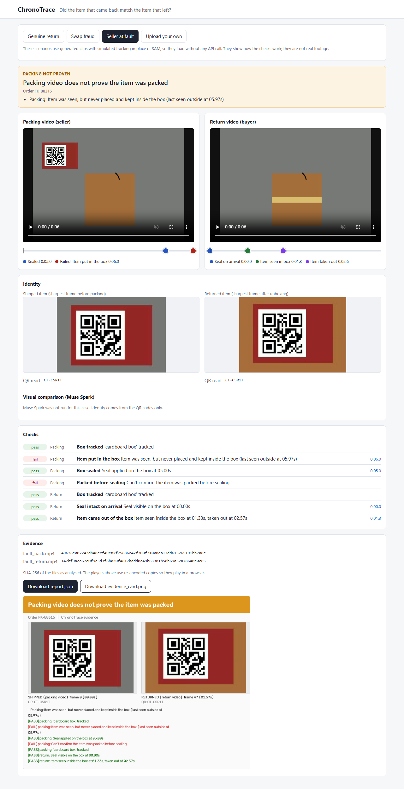
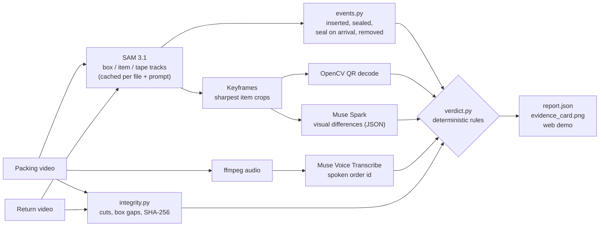

# ChronoTrace

**Did the item that came back match the item that left?**

Built for the Meta Global AI Developer Hackathon (indie developer track, theme: Build for
Your World).

Indian marketplace sellers lose money to return-swap fraud: a buyer returns a different,
older or empty item, and without proof of what was shipped the claim goes the buyer's way.
Tools like EasyEcom and Unicommerce already record packing videos and link them to orders,
but a person still has to watch the footage. ChronoTrace watches it.

Give it the seller's **packing video** and the **return-unboxing video**. It returns a
verdict, the evidence behind it (timestamps, matched frames, QR codes, named checks),
SHA-256 hashes of both files, `report.json`, and an evidence card built from real frames.



## How it works

| Step | What does it | Why |
|---|---|---|
| Track box, item and tape in both videos | **SAM 3.1** (Meta Model API), one request per concept | Pixel-accurate boxes per frame, zero-shot |
| Detect events: item inserted, box sealed, seal on arrival, item removed | Rules over the tracks (`events.py`) | Deterministic, every verdict traces to a named check |
| Pick the sharpest, unoccluded item frames | Laplacian variance on fixed-size crops | Motion blur makes labels unreadable |
| Identity: QR sticker on the item | OpenCV `QRCodeDetector` | Certain, no model guessing |
| Condition and visual differences | **Muse Spark** (`muse-spark-1.3`), structured JSON | Damage, marks, wear the QR can't show |
| Spoken order id | **Muse Voice Transcribe** + a normaliser for spoken forms | Catches the wrong video attached to a claim (review note only) |
| Edit check | Histogram cut detection, box-visibility gaps | Flagged as *needs review*, never as fraud |
| Evidence | SHA-256 of both files, report JSON, card from real frames | No generated imagery in evidence |

Insertion is detected as "the item's last observations are inside the box and it's never
seen outside again", not by following SAM object ids, because Meta's docs say ids aren't
reliable across full occlusion, which is exactly what happens when an item goes into a box.

Models supply evidence; `verdict.py` makes the call with fixed rules. No model output is
ever shown as a verdict or a confidence percentage.

### Architecture



### Verdicts

| Status | Meaning |
|---|---|
| `GENUINE_RETURN` | QR matches, no new damage |
| `RETURNED_WITH_DAMAGE` | Same unit, new damage visible |
| `SWAP_DETECTED` | QR codes differ |
| `SWAP_LIKELY` | No QR to confirm, but visible differences |
| `PACKING_NOT_PROVEN` | The seller's own video doesn't show the item packed before sealing |
| `NEEDS_REVIEW` | Not enough evidence for an automatic call |

`PACKING_NOT_PROVEN` is deliberate: the tool checks the seller's evidence first, so it is
neutral rather than a buyer-blaming machine.

## Run it

```bash
pip install -r requirements.txt
python -m pytest -q                 # offline, no key needed
python -m chronotrace serve         # web demo on http://localhost:8000, works with no key
```

The three preloaded scenarios (genuine return, swap fraud, seller at fault) load from saved
reports with no API call, so the demo works offline. They use generated clips with simulated
tracking, not real footage; the page says so.

With a key (put `MODEL_API_KEY=...` in the environment or an untracked `.env` file):

```bash
python -m chronotrace check         # API access, model ids, Spark fallback suggestion
python -m chronotrace verify packing.mp4 return.mp4 --order FK-88314 --item "earbuds case"
python -m chronotrace verify packing.mp4 return.mp4 --no-spark --no-voice   # SAM + QR only
python -m chronotrace verify packing.mp4 return.mp4 --refresh-prompt "packing tape"
python -m chronotrace bench data/clips/manifest.csv
python -m chronotrace prepare-demo --real data/clips/manifest.csv out/bench   # real cases in the demo
```

Output goes to `out/<order>/`: `report.json`, `evidence_card.png` and the best crops. Every
SAM, Spark and transcription response is cached in `cache/` by file hash and prompt, so
re-runs are free and reproducible. `--refresh` re-queries SAM for all prompts,
`--refresh-prompt` for one. Each process (a CLI run, or the web server for as long as it runs) refuses new API
calls once the estimated spend would pass $10.

If your key lists a different Spark model, set `CHRONOTRACE_SPARK_MODEL`; on a 404 the code
also falls back to the newest `muse-spark-*` the key lists.

`tools/sam_test.py` runs SAM on one clip, prints a per-object track summary and writes an
overlay video so you can eyeball the tracking. `tools/screenshots.py` captures the web demo
at desktop and phone width with Playwright.

## Filming guide

- Phone fixed top-down (stand or books), good light, 1080p 30 fps, 10–15 s.
- Packing: hold the item's QR to the camera ~1 s, place it in the box, close, tape.
  Optionally say the order id aloud ("order F K eight eight three one four").
- Return: show the taped box ~1 s, open, take the item out, hold it up ~1 s.
- Keep the box in frame the whole time.

Put clips in `data/clips/` and list them in `data/clips/manifest.csv` (see
`data/clips/README.md`).

## Results

**Real clips: not yet measured.** No real footage has been benchmarked yet. This section
will be filled only from a real `out/bench/summary.md`.

What has been checked so far:

- `python -m chronotrace bench --synthetic`: 3 of 3 generated scenarios get the expected
  verdict. That run uses a mock SAM fed with the clips' ground truth, so it tests the rules
  and plumbing, not real-world accuracy.
- The offline test suite also passes the three scenarios with 35% of frames dropped and
  12 px jitter in the mock tracks.
- The code has not yet been run against the live Meta Model API.

## Tests

```bash
python -m pytest -q
```

Covers the SAM wire-format parser, the three scenarios end to end on synthetic clips,
every verdict branch, retries and error handling, caching rules (a failed call never writes a
cache entry, per-prompt refresh), the budget guard, phone rotation flags, the bench command,
the web API with no key set, and the spoken order id normaliser.

## Limits

- Not yet validated on real footage or against the live API. Real SAM output will be
  noisier (hands, shadows, clutter) than the mock; thresholds in `config.py` may need tuning.
- Edit detection catches hard cuts, not deepfakes or careful re-recording, and only ever
  produces "needs review".
- Identity without a QR is a visual likelihood, not proof.
- SAM object ids are not stable across occlusion, so events are inferred from where the
  item was last seen, which assumes a fixed top-down camera with the box in frame.
- The spoken order id check relies on the transcript; a mismatch is a review note, never a
  verdict. The transcription response fields come from the docs and haven't been observed live.
- Rotation: the video's rotation flag is applied explicitly; if a file has no readable flag,
  crops fall back to matching SAM's reported aspect, assuming the usual 90 degree phone case.
- The platform still decides the claim; this produces evidence, not a ruling.

## Future work

- Run the tuning loop and benchmark on real clips filmed per the guide.
- Pull packing videos directly from EasyEcom / Unicommerce by order id.
- Use SAM masks (not just boxes) for tighter "inside the box" tests on cluttered tables.
- Tamper-evident storage of the report and hashes at packing time.
